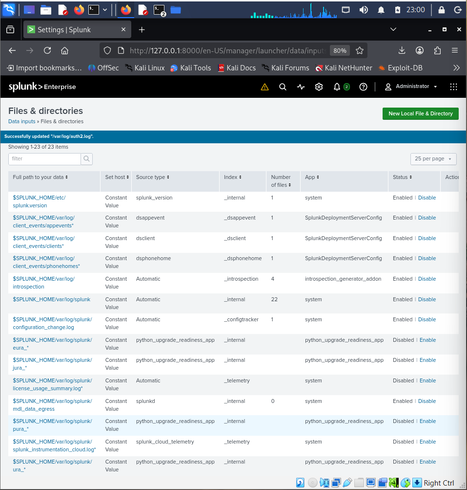
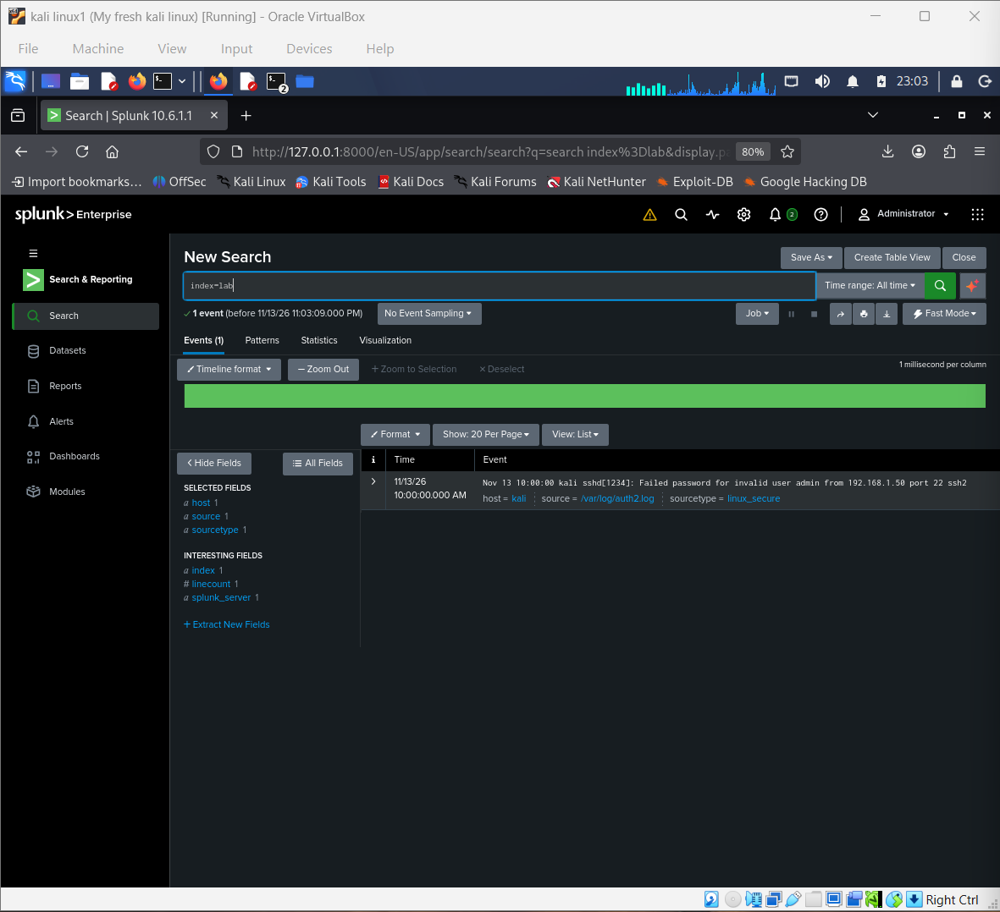
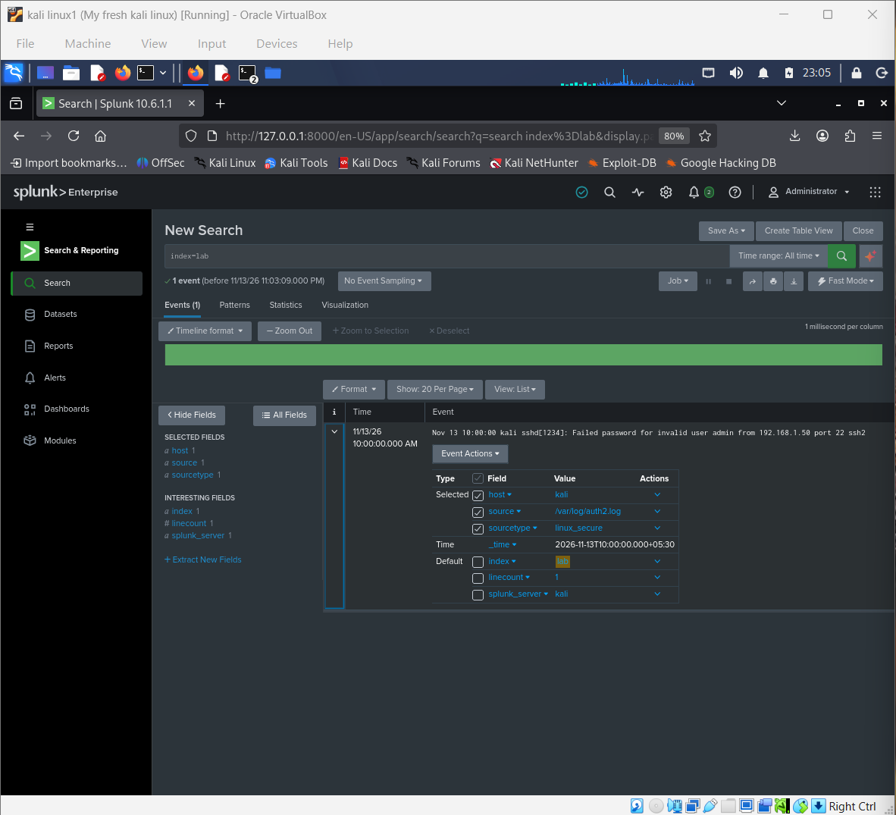

# Hands-On Task 2: Ingest Logs into Splunk

## 1. Objective
To ingest local log data into the Splunk `lab` index and verify the events via SPL search.

## 2. Ingestion Flow Documentation
The log data successfully flowed through the following pipeline:
**Log Source → Forwarder → Indexer → Search Head**
- **Log Source:** `/var/log/auth2.log` (A local Linux authentication log file containing a simulated failed SSH login attempt).
- **Forwarder:** The Splunk File Monitoring input (acting as a local forwarder) was configured to monitor the file for new events.
- **Indexer:** The Splunk Enterprise instance received the data, parsed it using the `linux_secure` sourcetype, and stored it in the `lab` index.
- **Search Head:** The Splunk Web interface where the SPL query `index=lab` was executed to retrieve the event.

## 3. Screenshots & Evidence

### Screenshot 1: Forwarder / Data Input Configuration
This screenshot shows the Splunk web interface confirming that the `/var/log/auth2.log` file has been successfully added as a data input and is routing to the `lab` index with the `linux_secure` sourcetype.

### Screenshot 2: Successful Search `index=lab`
This screenshot demonstrates that the data ingestion was successful. The query `index=lab` returns 1 event, proving that Splunk is actively reading the log file.

### Screenshot 3: Auth.log Event Details
This screenshot shows the expanded event details for the ingested log. It clearly displays the raw log (Failed password for invalid user admin), along with the correctly parsed fields: `host=kali`, `source=/var/log/auth2.log`, and `sourcetype=linux_secure`.

