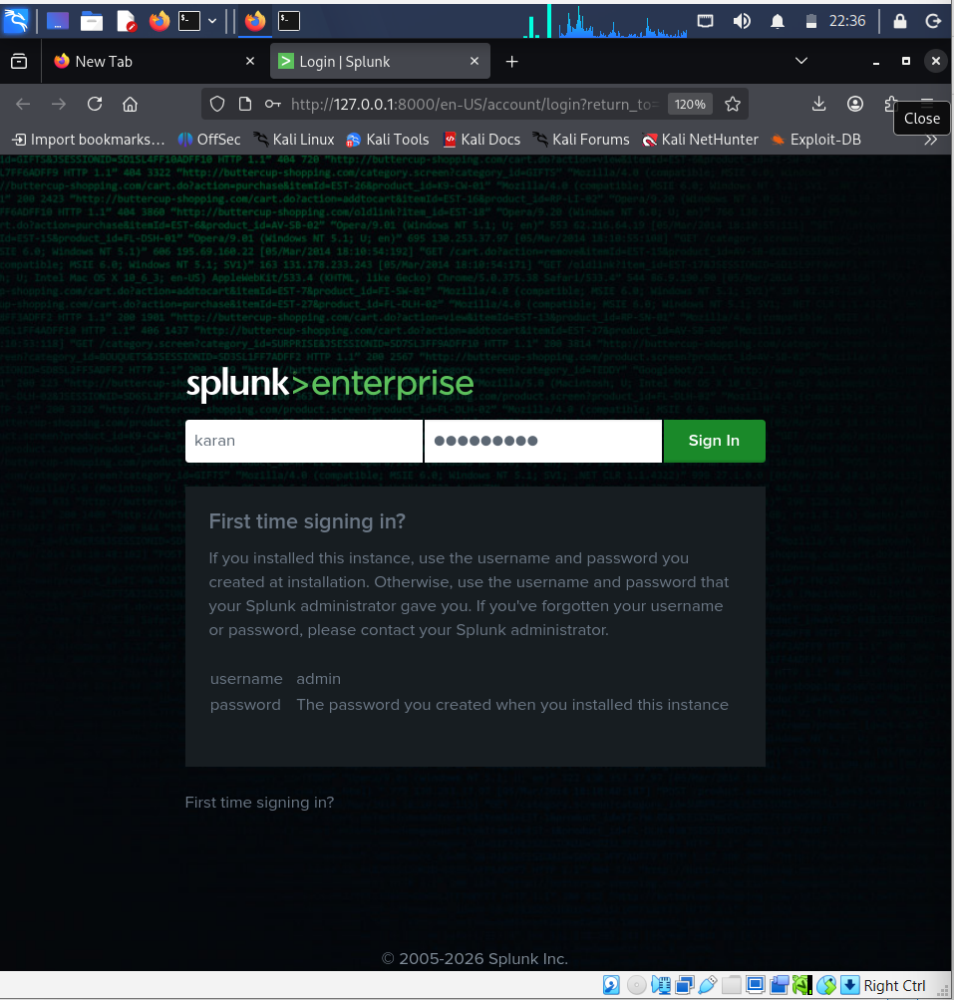
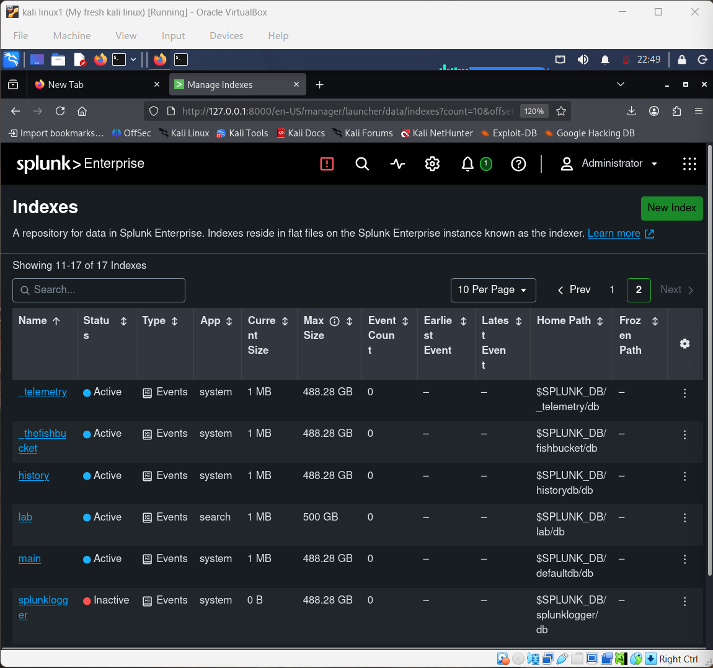

# Hands-On Task 1: Install Splunk Enterprise

## 1. Objective
Install Splunk Enterprise on a Linux machine, start the service, and create a dedicated index named `lab` to receive logs.

## 2. Environment Details
- **Operating System:** Kali Linux (VirtualBox VM)
- **Splunk Version:** Splunk Enterprise (Free License)
- **Access URL:** `http://127.0.0.1:8000`

## 3. Installation Process
1. Downloaded the Splunk Enterprise `.deb` package for Linux.
2. Installed the package using the terminal command: `sudo dpkg -i splunk-*.deb`.
3. Started the Splunk service and accepted the license using: `sudo /opt/splunk/bin/splunk start --run-as-root --accept-license`.
4. Created the administrator account (Username: `karan`).

## 4. Screenshots & Evidence

### Screenshot 1: Splunk Login Page
The following screenshot proves that the Splunk web interface is running successfully and accessible.

### Screenshot 2: Empty `lab` Index Created
After logging in, I navigated to **Settings > Indexes**, clicked on **New Index**, and created an index named `lab`. The screenshot below shows the index successfully created and currently empty (0 events), ready to receive data.

## 5. Conclusion
A fully functional Splunk instance is now running with a dedicated `lab` index. This environment is ready for log ingestion and SPL querying tasks in the upcoming labs.