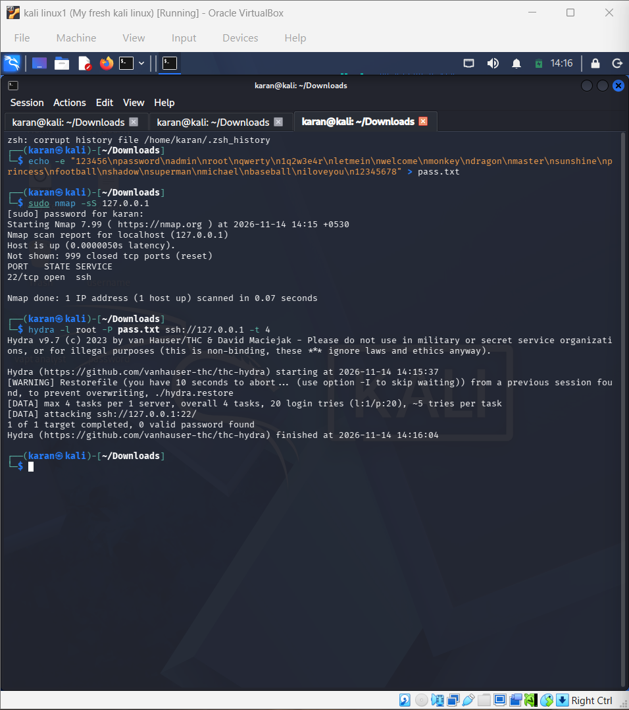
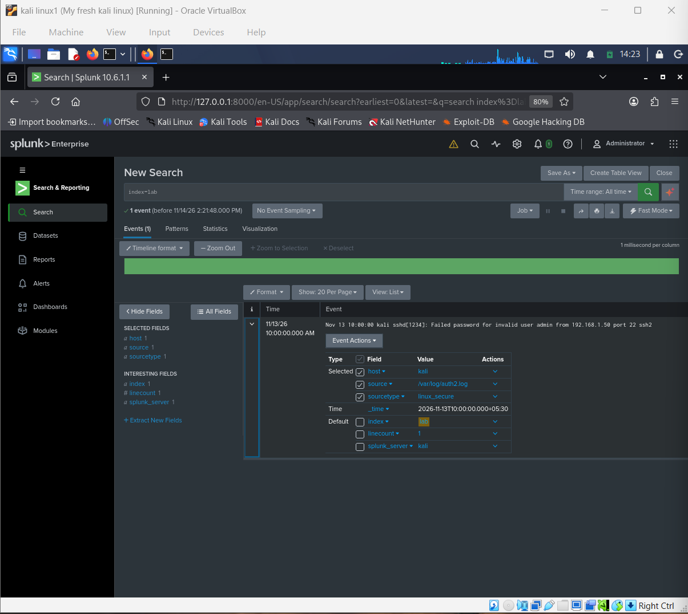
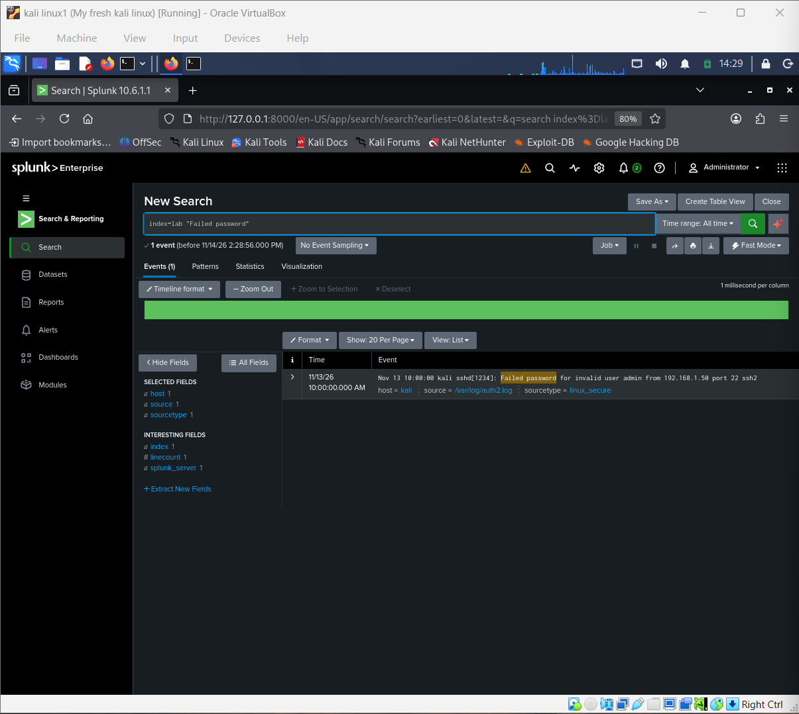

# Hands-On Task 4: Attack to Alert

## 1. Objective
Simulate an SSH brute force and Nmap scan from Kali Linux (targeting localhost) and detect the activity using Splunk.

## 2. Attack 1 & 2: Nmap Scan and Hydra Brute Force
- **Attacker Command:** `sudo nmap -sS 127.0.0.1` and `hydra -l root -P pass.txt ssh://127.0.0.1 -t 4`
- **Raw Event (SIEM):** After the Hydra attack, Splunk captured multiple "Failed password for root from 127.0.0.1" events.
- **Parsed Fields:** 
  - `src_ip`: 127.0.0.1 (Attacker IP)
  - `user`: root (Target User)
  - `action`: failed_login
  - `sourcetype`: linux_secure
- **Manual Search:** Used the SPL query `index=lab "Failed password"` to surface and verify the brute force activity.

## 3. Screenshots
### Screenshot 1: Attacker Commands

### Screenshot 2: Raw Event & Parsed Fields

### Screenshot 3: Manual Search
