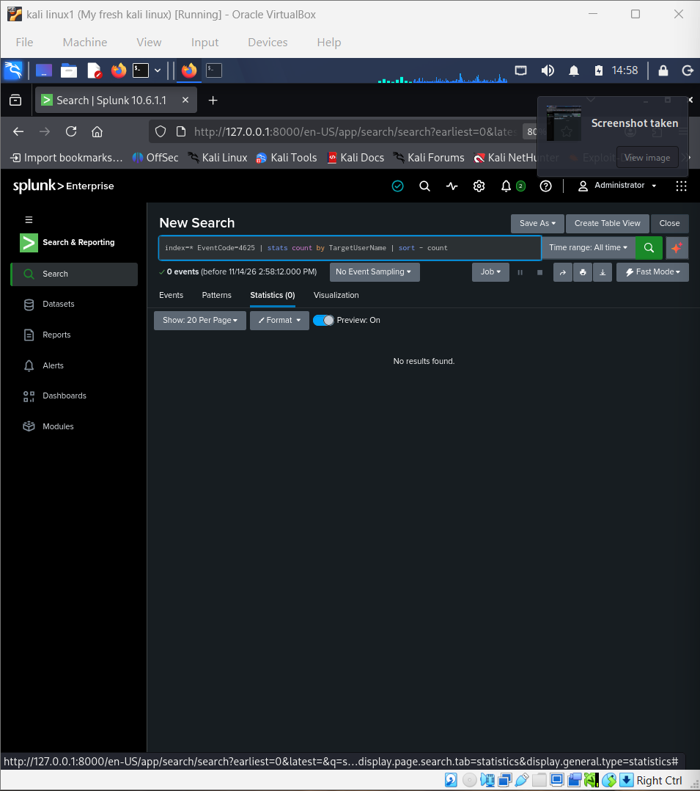
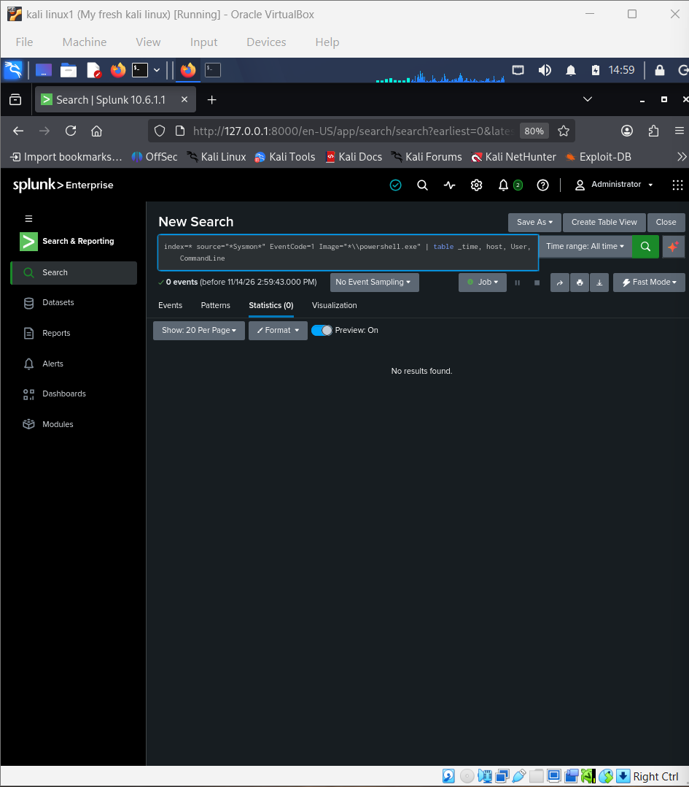
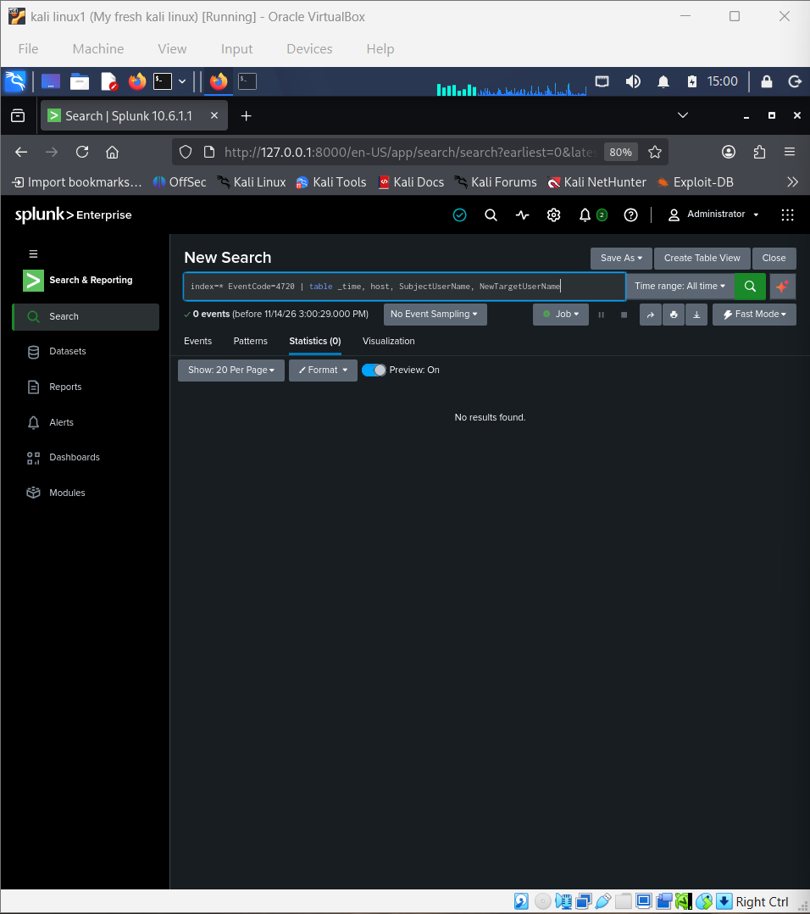
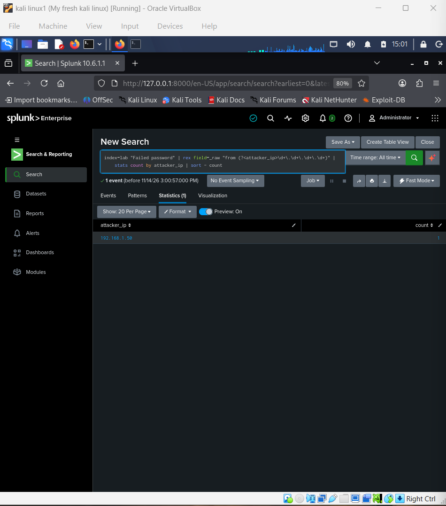
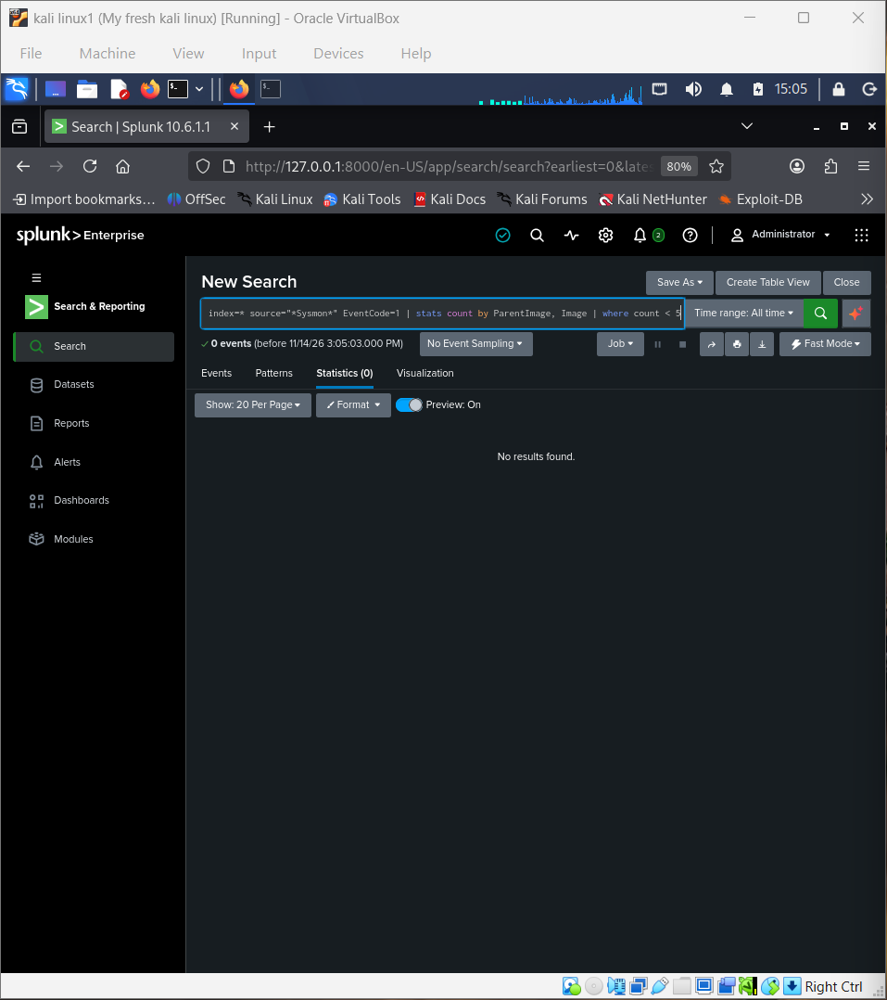
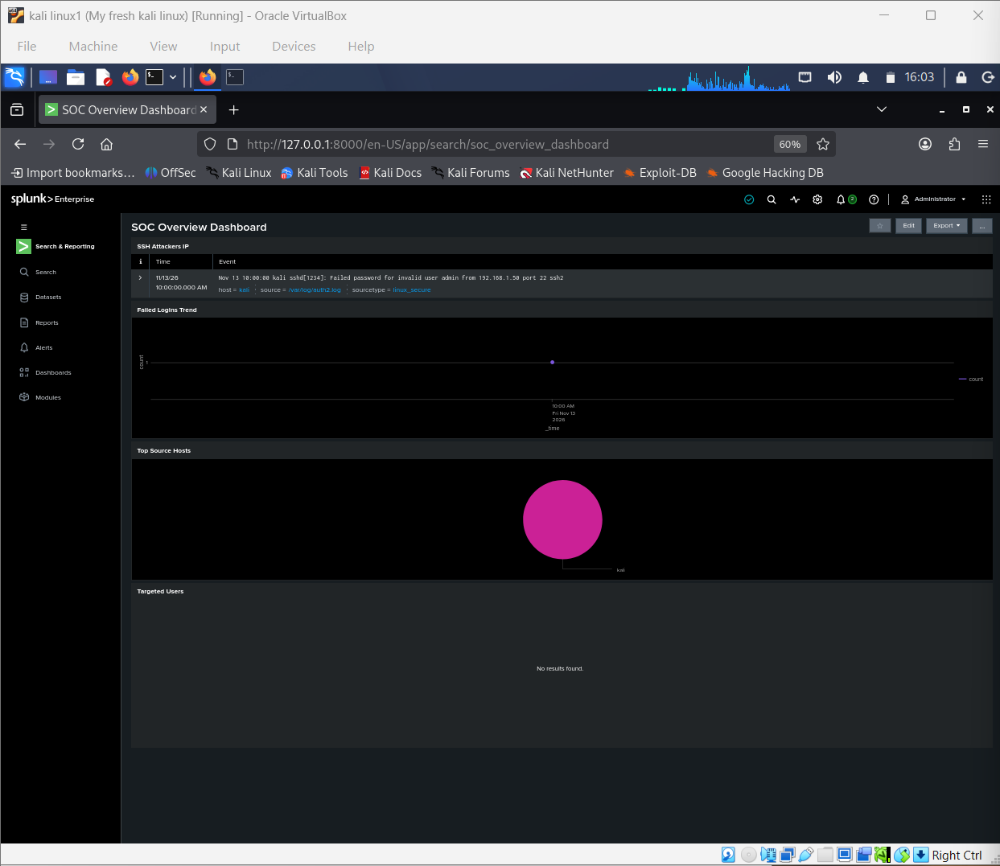

# Hands-On Task 5: Detections & Dashboards

## 1. Objective
Write 5 SPL detection queries, create scheduled alerts, build a 4-panel dashboard, and write a custom Wazuh rule.

## 2. SPL Searches & MITRE Mapping

### Search 1: Failed Logons (EventCode 4625)
- **SPL:** `index=* EventCode=4625 | stats count by TargetUserName | sort - count`
- **MITRE:** T1110 (Brute Force)
- **Why L1 needs this:** Helps the analyst quickly identify which specific user accounts are being targeted by brute-force attacks.

### Search 2: PowerShell Execution (Sysmon Event 1)
- **SPL:** `index=* source="*Sysmon*" EventCode=1 Image="*\\powershell.exe" | table _time, host, User, CommandLine`
- **MITRE:** T1059.001 (PowerShell)
- **Why L1 needs this:** Attackers heavily rely on PowerShell for execution and lateral movement. This query reveals exactly what commands are being run.

### Search 3: New User Creation (EventCode 4720)
- **SPL:** `index=* EventCode=4720 | table _time, host, SubjectUserName, NewTargetUserName`
- **MITRE:** T1136 (Create Account)
- **Why L1 needs this:** Detects persistence mechanisms where attackers create backdoor accounts to maintain access.

### Search 4: SSH Failures per Source IP
- **SPL:** `index=lab "Failed password" | rex field=_raw "from (?<attacker_ip>\d+\.\d+\.\d+\.\d+)" | stats count by attacker_ip | sort - count`
- **MITRE:** T1110 (Brute Force)
- **Why L1 needs this:** Instantly identifies the source IP addresses responsible for SSH brute-force attempts.

### Search 5: Rare Parent-Child Process Pairs
- **SPL:** `index=* source="*Sysmon*" EventCode=1 | stats count by ParentImage, Image | where count < 5`
- **MITRE:** T1055 (Process Injection) / T1566 (Phishing)
- **Why L1 needs this:** Flags highly anomalous behavior (e.g., Microsoft Word spawning a CMD shell), which is a strong indicator of a compromised host.

---

## 3. Scheduled Alerts
Configured 2 scheduled alerts to automate detection:
- **Alert 1:** SSH Brute Force Detection (Runs hourly, Triggers if results > 0).
- **Alert 2:** Failed Logons Alert (Runs hourly, Triggers if results > 0).

---

## 4. Dashboard
Built a 4-panel "SOC Overview Dashboard" containing charts for SSH Attackers, Failed Logins Trend, Top Source Hosts, and Targeted Users.

---

## 5. Custom Wazuh Rule
- **Rule ID:** 100051
- **Level:** 10
- **Detection Logic:** Matches the string `hack_attempt`.
- **Test:** Successfully verified using `/var/ossec/bin/wazuh-logtest`.

---

## 6. Screenshots

### SPL Search 1: Failed Logons

### SPL Search 2: PowerShell Execution

### SPL Search 3: New User Creation

### SPL Search 4: SSH Failures

### SPL Search 5: Rare Processes

### Scheduled Alerts Configuration
**Alert 1:**

**Alert 2:**

### 4-Panel Dashboard

