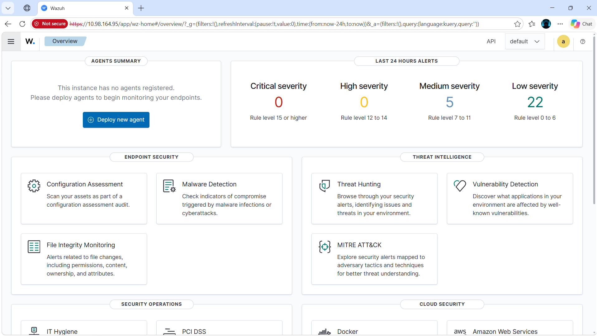
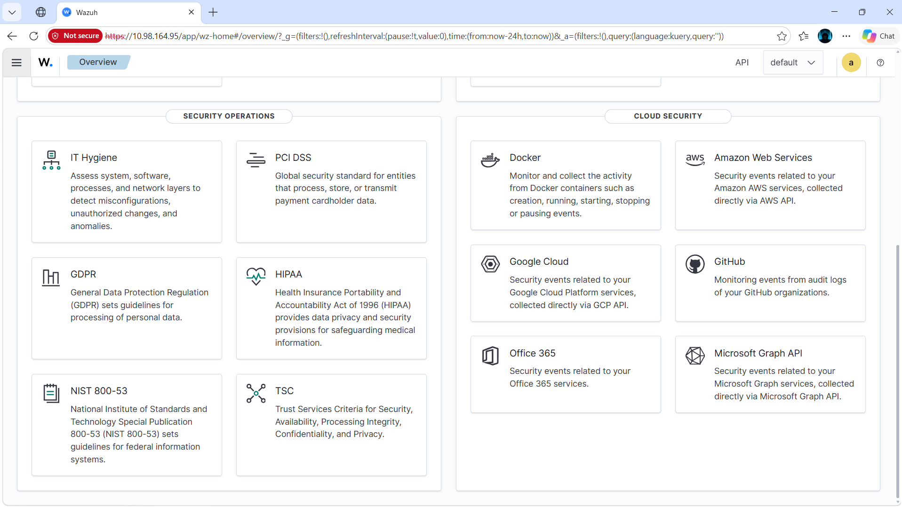
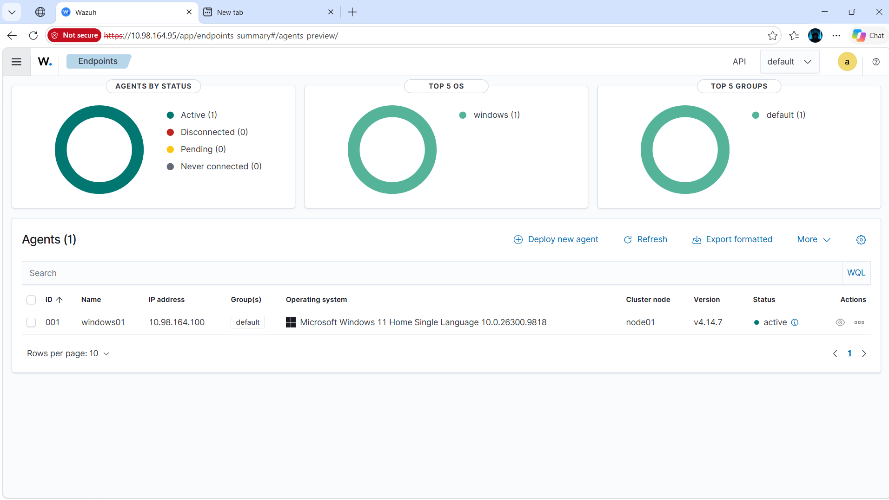
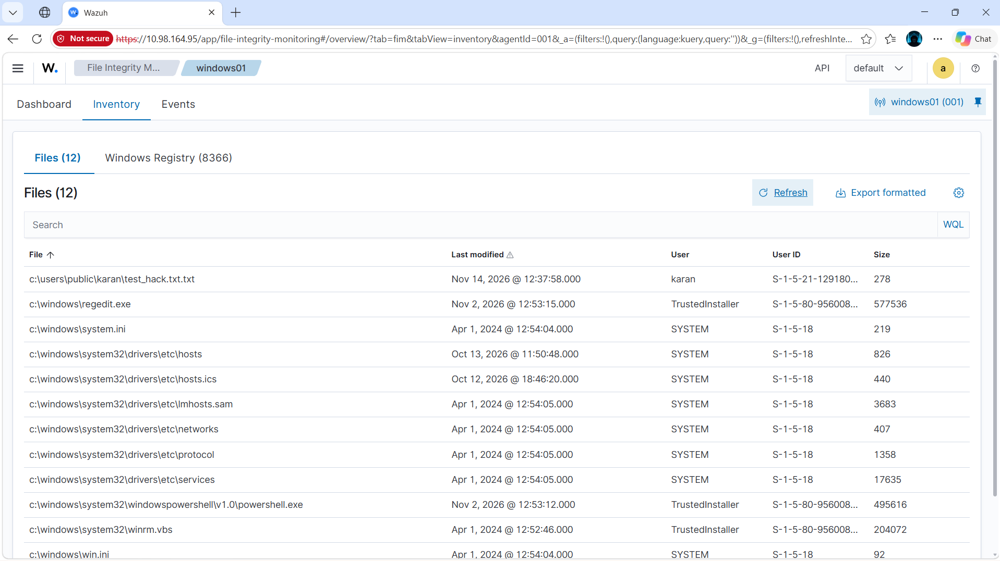

# Hands-On Task 3: Install Wazuh and Configure FIM

## 1. Objective
Install Wazuh on a VM, enroll a Windows agent, and configure File Integrity Monitoring (FIM) to detect changes in a test folder.

## 2. Environment Details
- **Wazuh Server:** Installed on a VirtualBox VM (IP: 10.98.164.95).
- **Wazuh Agent:** Installed on a Windows 11 VM.
- **Test Folder:** `C:\Users\Public\karan` (with `test_hack.txt` inside).

## 3. Screenshots & Evidence

### Screenshot 1: Wazuh Dashboard Overview
This is the main dashboard after successful installation, showing the overall security posture and alerts.

### Screenshot 2: Enrolled Agents
This screenshot shows the Windows agent (`windows01`) successfully enrolled and reporting as "Active" to the Wazuh manager.

### Screenshot 3: File Integrity Monitoring (FIM) Tracking
After modifying the `test_hack.txt` file inside `C:\Users\Public\karan`, Wazuh successfully tracked the file. The screenshot below shows the file detected and listed in the Wazuh FIM Inventory module, confirming the file monitoring is fully functional.

